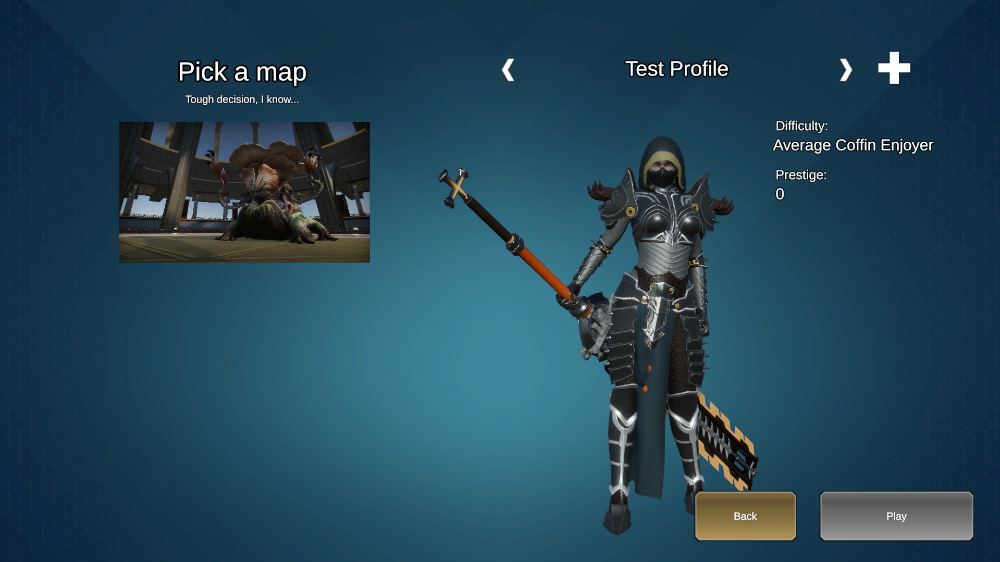
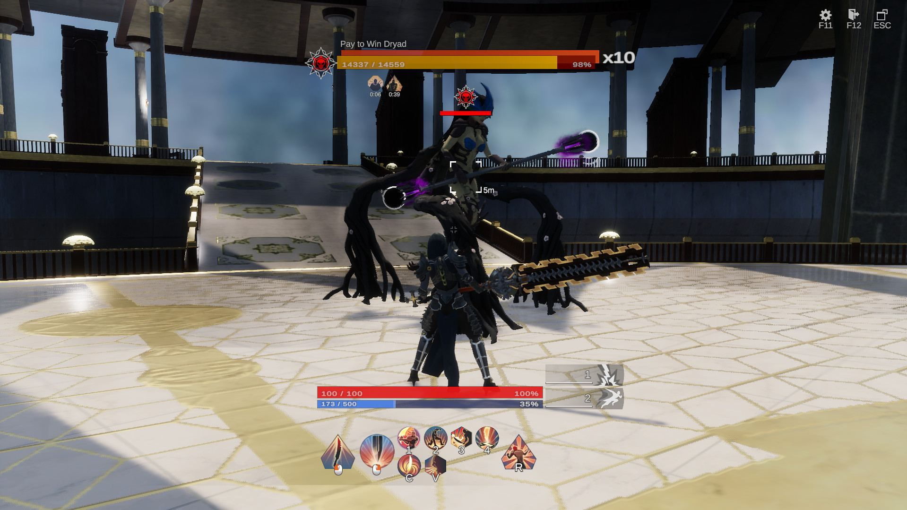
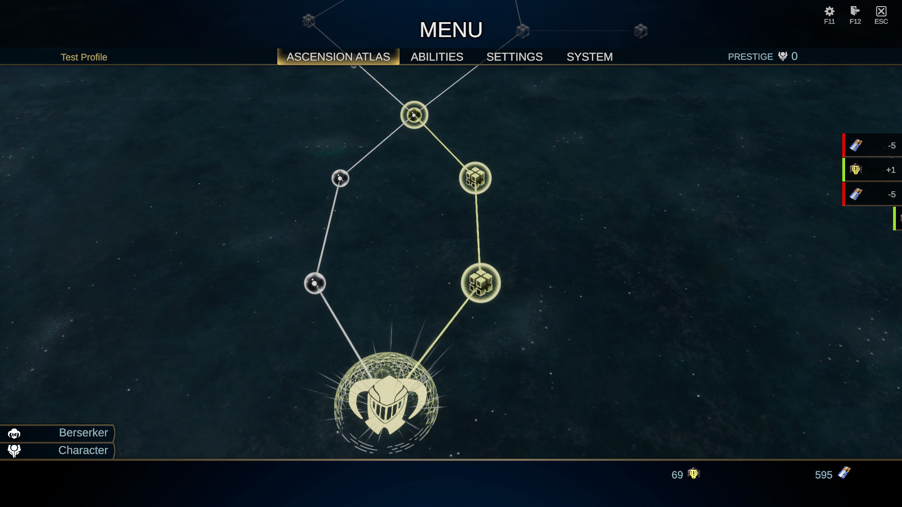
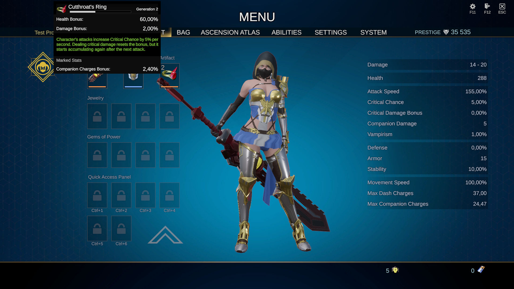
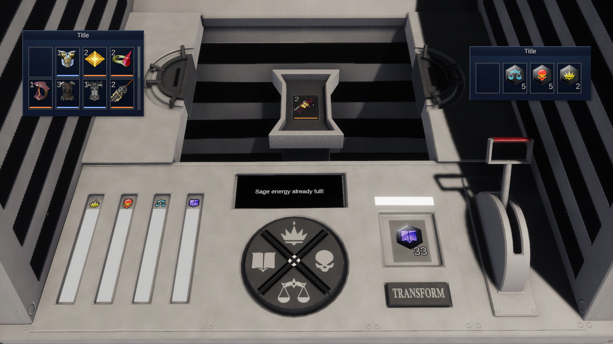
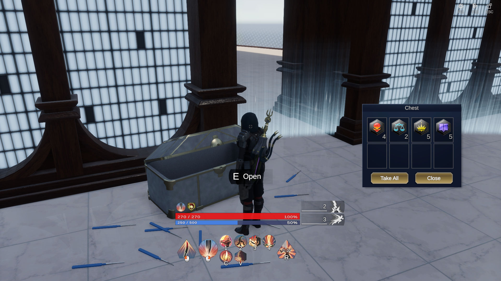
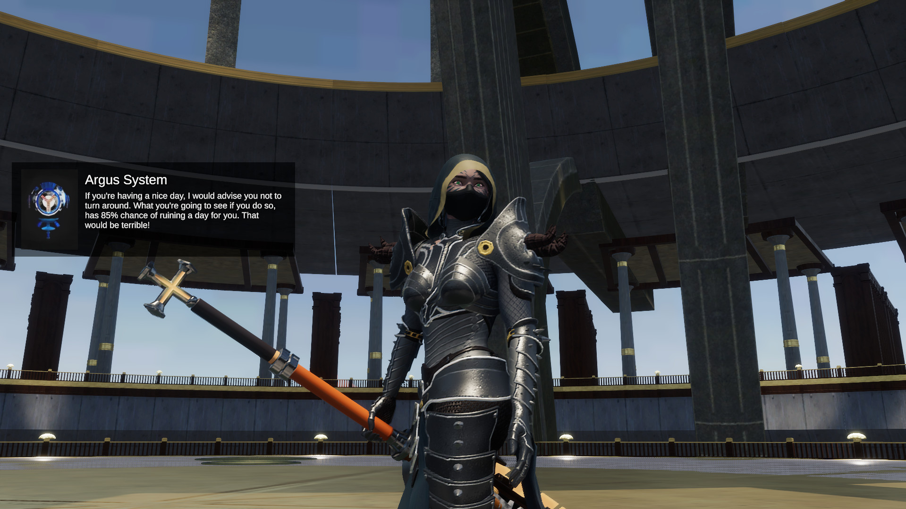

# Skyforge Unity Remake
## The game that once made us Immortal, now needs to be resurrected.

This game will be aimed at people who miss the original Skyforge. The combat system, the character classes, the worldbuilding and the climate of the original game will be slowly re-created, as the development progresses. For now, it’s just a short presentation of a game, with one quickly assembled Divine Observatory map, remade as a short dungeon, some key systems already implemented, and the fully finished Berserker class to try out.

There are plenty of in-game systems already working, such as the whole combat system, Ascension Atlas, cutscene system or player profiles. Half of the Pythonides faction is implemented, with Dione basic enemy, Dryad boss and Entid boss, summoning healing Triffids. The Divine Observatory Test Dungeon is fully playable, although the map itself, design-wise was assembled in a hurry, just to have a place to test things out. Fully visually designed maps will appear in the future, once all the desired systems are ready.

The Ascension Atlas prototype that is already implemented strongly resembles the first version of the atlas, first for the character, where all the classes and symbols are unlocked and casual stats are improved. Once the class is unlocked, the second atlas appears, with class abilities and class-specific symbols to unlock. There are also basic stat nodes in the class atlas, but they will work only while the player uses this specific class. Naturally, more bulky stats like HP and Defense will appear in tank class atlases, more DPS nodes like attack speed and damage will appear in the DPS ones etc. This way, classes will not be automatically better in their field of expertise, but rather will have a bigger upgrade potential, and will become better over time. This approach gives as much freedom and room to experiment as the original atlas system, from before the infamous Ascension Update.

There is a resource needed to unlock the atlas nodes, called Eidos, inspired by the invasion Eidoses from later versions of the game. For now, there’s just one type of those, but in the future, many types will be added. Specific nodes will require their specific type of Eidoses, so that the player would have to prioritize a certain types of missions/enemies in order to quickly progress. For now, Aelion Eidoses are available to purchase in the vending machine close to the player’s spawn point in the Divine Observatory for as little as 5 Credits each. Player profile will have 1000 Credits, meaning 200 Eidoses in total, which is not enough to unlock full Atlas, so pick what suits you the most. This will change when a proper reward system is implemented.

The next implemented feature is the equipment system. As the game aims to be single-player, all kinds of oppressive MMO mechanics made to squeeze the real money from players are removed. Item classification to common/rare/mythical/legendary persists, but in a different form. Completely new inventory upgrades has been introduced. Generation of items is increased when the player has them equipped and kills enemies. Once the bar on the top of the item's tooltip is filled, player can increase their Generation, using special items of rebirth that can be dropped from chests. The functional armor is also introduced with its own bonuses and buffs. In the future, there will be an option to customize the character's appearance regardless of armor they wear, but in order to unlock a specific armor in the style room, said armor would have to be acquired by the player first.

Another form of upgrading gear is called Ether Transformation. The process takes place in a special location, where the Ether Transformer machine stands. To start a special upgrading minigame, Marks of Sage, Marks of King, Marks of Assasin and Marks of Judge are needed as a resource. During the minigame, the player has to fill the energy in four buttons to a pattern of their choice. The result of this minigame is a Marked Bonus on the item that replaces Secondary Bonuses from the original game. Bonuses can be raised when the minigame is performed again. Each item has 20 so called Ether Fibers that represent the stage of completion of Marked Bonus. Once the player performs the minigame 20 times, all the Ether Fibers on the item are complete. Then, the player can improve each Fiber separately to reach 100% of their potential, and max out the Marked Bonus.

During adventures, there will be chests to find (sometimes with guards), with a separate loot, adequate to the dungeon’s level. The player would also have an option to unload their bag with a kind of external storage located likely in their headquarters.

The next aim is to create a new map, rework the location switching mechanics, introduce dungeon rewards on completion, and custom difficulty settings in form of Nightmare versions for each of the playable map. The Ascension Atlas will also be expanded, and new nodes will be added.

The game contains assets that imitate the originals, but it does not include any original asset from Skyforge.

## Getting Started

Requirements:
Unity 6000.3.18f1 - recommended version

Steps:
1. Clone this repository.
2. Open UnityHub
3. Go to Projects -> Add -> Add project from disk
4. Choose the path to the downloaded repository
5. Open the project and wait until all the packages are installed

## Current focus

Here are the things that are worked on, or will be in the near future:

- [x] In-game menu that would resemble one from the original game
- [x] Ascension Atlas
- [x] Equipment System
- [ ] Character customization
- [ ] Character facial animations and idle animation variation
- [ ] Extended non-combat functionalities like interacting with objects or jumping
- [ ] Skipping cutscenes
- [ ] Second map with new types of enemies and bosses 
- [ ] Dungeon finish screen, with rewards, statistics etc.

## License

The source code of this project is licensed under the MIT License.

See [LICENSE](LICENSE).
